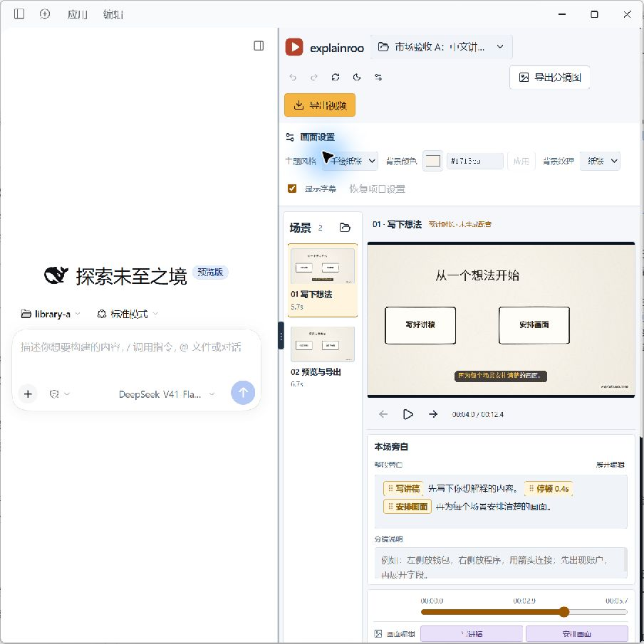

# DSH Explainroo

在 DSH Desktop 中制作讲解视频：用原生对话创作，在右侧工作台逐场预览、编辑，再导出视频或分镜图。



[旁白与触发点](.github/screenshots/narration.jpg) · [原版默认配音](.github/screenshots/voice-settings.jpg) · [上架材料与验收记录](docs/market-listing.md)

## 功能

- **原生对话协作**：保留 DSH 的模型、工具与会话；在输入框用 `@` 引用当前项目、场景和画面对象。
- **多项目工作台**：选择工作台目录，在项目面板搜索、切换或创建项目；空目录可初始化，零场景显示起始画布。
- **旁白编辑**：触发点嵌在连续正文中，可拖动、不可误删；支持中文输入、整段粘贴、展开编辑与本地撤销重做。
- **中文名称**：场景和触发点直接使用中文。改名联动讲稿、画面代码、封面和手动时序，无额外显示名或翻译表。
- **画面调整**：修改主题、背景色、纹理、字幕，以及对象的位置、尺寸、文字、颜色、入场和触发时间。
- **修改保护**：保存需匹配最新 revision；保留锁定、手动覆盖和历史。右键可复制纯 JSON 定位内容。
- **导出**：顶栏导出视频或分镜图，后台显示百分比，完成后选择保存位置。配音方式在设置中配置。
- **创作 skill**：附带 DSH 指引和自有中文示例；安装工作区技能时读取原版指南，引导分镜说明和无声验证。
- **界面**：默认亮色，可单击切换暗色；支持调整原生对话与工作台的宽度。窄分栏将场景改为横排，预览、时间和属性改为单列显示。

## 环境与兼容性

- Node.js `^22.19.0 || >=24.0.0`。
- Explainroo 0.4.1 通过官方仓库固定提交作为外部依赖安装；Git 仓库和插件 tgz 不包含引擎源码、字体或上游示例，首次安装需要访问该源码包地址。
- 图形工作台依赖 DSH Desktop 的 `desktopWorkbenches` 服务。
- 当前 0.8.2 已在 Windows x64 的 Desktop 0.12.0 / Harness 0.2.0-rc.2 安装并打开验证；开发依赖固定为 Harness 0.2.1-rc.2，peer 同时接受这两个预发布分支。历史 0.7.2 另有 Desktop 0.11.1 的验收记录。
- 导出视频需要 FFmpeg 和引擎支持的 Chrome / Edge。旁白预览不自动生成语音；中文字体首次使用可能下载。

上述为已验证的版本范围。独立 Harness Web 未提供 Desktop 工作台服务时，可使用 Host 工具，不能加载本图形面板。

## 安装到 DSH Desktop

已发布版本可直接从 [GitHub Releases](https://github.com/AloneAtWar/dsh-explainroo/releases) 下载 `dsh-explainroo.tgz`，无需本地构建；也可从源码构建：

```powershell
npm ci --ignore-scripts
npm run check
npm pack
```

通过 DSH Desktop 支持本地文件的插件安装入口选择下载或构建得到的 tgz（Release 为固定文件名 `dsh-explainroo.tgz`，本地构建为 `dsh-explainroo-<版本>.tgz`），再重启 Harness，在工作台主页打开「讲解视频工作台」。使用 CLI 时应使用当前 Desktop 自带的运行时与 profile；全局 Harness CLI 可能安装到其他位置。

首次进入设置工作台路径。默认使用固定版本的原版 Explainroo 依赖。中文 ID 和 MiMo 由插件适配；原始项目不会改成英文 ID，也不修改外部引擎。高级引擎目录仅用于自行验证过的兼容版本。

安装状态会显示界面、后台和引擎版本。更新后若提示版本不一致，请用 Desktop「应用 → 重启」，仅刷新页面不会更新 Host。默认引擎随插件自动安装，不需要单独克隆 Explainroo 或填写目录；安装中断时可展开「安装与修复引导」重新安装并重启，再点「重新检测」。失效的自定义路径可用「恢复默认引擎」清除；工作台目录与视频文件保持不变。

0.8.0 改变了引擎分发方式。已有项目可继续打开，锁定和历史仍保留；旧的自定义工作区 skill 不自动覆盖。旧脚本若直连旧引擎，优先使用 Host 工具，备份自定义指引后再安装新 skill。

## 开始创作

1. 顶部选择或新建视频项目。新项目保存在工作台下的 `projects/<目录名>/`。
2. 在 DSH 原生对话中描述主题，使用 `@` 引用项目或场景。
3. 预览画面，编辑本场旁白与分镜说明，保存修改。分镜说明记录构图、对象关系和动画顺序，不参与朗读。
4. 拖动正文中的触发点改变位置，右键改名或复制定位 JSON。改名前先保存当前草稿。
5. 在设置中选择配音服务与音色，点击顶栏导出并选择保存位置。

新建项目包含 `video.json`、`script.md`、`scenes.js`、忽略规则和 `.dsh/skills/explainroo/`。已有自定义 skill 不覆盖；运行时指引提供工作台工具说明。

## 本地开发

```powershell
npm ci --ignore-scripts
npm run demo:import
npm run dev -- --library ./.local/projects
```

默认复制包内中文示例到忽略的本地目录；也可用 `npm run demo:import -- <项目路径>` 复制自己的项目。目标已存在时拒绝覆盖。

打开终端显示的 `http://127.0.0.1:4480/`。开发页面复用同一个 Host、真实引擎与保存逻辑，用于预览和编辑；AI 对话继续使用 DSH。可通过 `--port`、`--library`、`--engine`、`--data-dir` 调整开发入口。

```powershell
npm run typecheck
npm test
npm run check
npm pack --dry-run --ignore-scripts
```

CI 在 Windows 和 Linux 的 Node 22 / 24 上执行完整检查与打包预检。TypeScript 同时检查未使用的声明。推送 `v*` 标签会重复完整检查后创建 GitHub Release，附上固定文件名的 `dsh-explainroo.tgz`（供 `releases/latest/download/` 链接引用）并通过 8 MiB 体积守卫；配置 `NPM_TOKEN` secret 后，Release 发布时自动执行 `npm publish --provenance`。

插件自身的 `lib/` 构建产物随源码提交，供源码安装和市场源码核验使用。修改源码后运行 `npm run check`，同时提交更新后的 `lib/`；CI 和 Release 会检查重新构建的文件与提交内容一致。Explainroo 引擎继续使用固定提交的外部依赖。

## DSH 工具

| 工具 | 用途 |
| --- | --- |
| `explainroo_setup` | 读取状态，按请求配置工作台和引擎目录 |
| `explainroo_project` | 读取场景、锁定、覆盖和最新 revision |
| `explainroo_edit_scene` | 修改单场旁白、分镜说明或已有画面对象 |
| `explainroo_rename` | 关联修改场景或触发点名称 |
| `explainroo_validate` | 无声检查场景、触发点、封面与手动时序引用 |
| `explainroo_run` | 使用 DSH Jobs 执行 voice / check / sheet / render |

后台工具返回 native job id，通过 `job_output` 取结果、`job_kill` 取消。界面只显示紧凑进度和错误提示。

## 文件、配音与边界

- 真源为项目的 `script.md`、`scenes.js` 和 `video.json`；手动覆盖、撤销历史与导出快照保存在项目 `.explainroo/`。
- 配音设置优先沿用项目的 provider、音色、模型或录音来源；未指定 `voice` 时采用原版 Explainroo 的语言默认值（当前中文为 Kokoro `zf_xiaobei`）。新建项目与中文示例不再预设 MiMo，已有 MiMo 项目仍保留原配置。保存设置不会生成配音。
- 视频导出按需生成缺失或失效的配音。MiMo / ElevenLabs 可能收费；分镜图和无声预览不调用 TTS。设置不保存 API Key。MiMo 使用本机 `MIMO_TTS_API_KEY` 或项目 `.env`，兼容旧 `MIMO_API_KEY`；ElevenLabs 使用 `ELEVENLABS_API_KEY`。
- 预览与任务使用同一兼容层，在副本中转换中文场景、触发点、封面及静态 JS 引用；保留可见文字和颜色。所有任务在独立快照中运行，原文件仍是唯一真源。
- MiMo 由插件生成音频，经原版录音入口完成词级对时与渲染。有效配音缓存可复用；新缓存仅在项目 revision 未变时按原中文名称回写。
- 复杂 `s.draw`、嵌套组件和自定义动画继续由代码维护；目前没有任意 JavaScript 的可视化反编译或专业多轨剪辑。
- 静态验证不执行项目 JS；无法确认的动态定义会报错，实际画面仍需预览。录音缓存识别和按场景迁移仍有限制。
- 工作台设置保存在用户目录 `~/.dsh-explainroo/settings.json`。卸载插件不删除视频项目。

## 项目结构

```text
src/
├── client/          # 原生业务面板、编辑器与交互
├── host/            # 项目、事务、预览、导出与技能安装
├── player/          # 引擎画布和预览消息
├── shared/          # 协议、数据类型和场景适配器
└── dev/             # 浏览器开发入口
skills/explainroo/
├── SKILL.md
├── scripts/         # 创作 CLI 与无声验证
├── references/      # 中文命名、分镜说明及创作参考
└── examples/        # 插件自有中文示例
scripts/              # 开发、构建与打包检查
tests/                # 行为与真实引擎集成测试
docs/                 # 架构、设计和验证说明
```

[架构](docs/architecture.md) · [设计](docs/design.md) · [验证](docs/verification.md) · [创作 skill](skills/explainroo/SKILL.md) · [第三方许可](THIRD_PARTY_NOTICES.md)

[上游版本与维护流程](docs/upstream-maintenance.md) 说明固定提交、完整性校验、兼容副本和升级验收。

本插件采用 MIT 许可，外部依赖保留各自许可。开发参考 [dsh-oil-creator](https://github.com/oil-oil/dsh-oil-creator)、[DeepSeek Harness](https://github.com/deepseek-ai/deepseek-harness)、[DSH Desktop 工作台规范](https://dshdesktop.com/workbench/docs/development/) 和 [explainroo](https://github.com/vincentsch/explainroo)。
